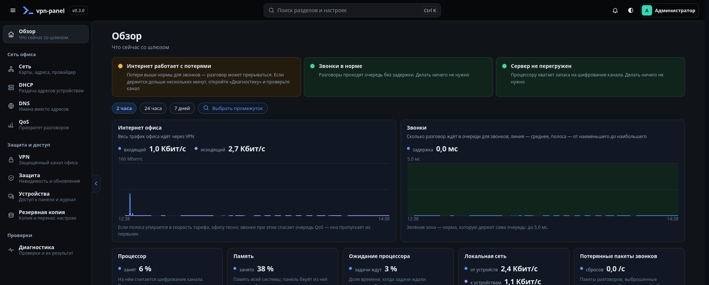
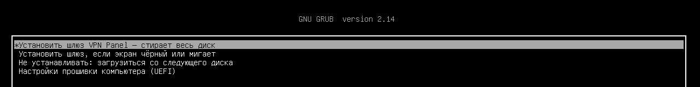

# VPN Panel

Веб-панель для офисного VPN-шлюза на Ubuntu. Ставите её на отдельный компьютер
с двумя сетевыми картами — и управляете всем офисным интернетом из браузера: кто
выходит в сеть, через какой канал, как раздаются адреса, куда смотрит DNS, и
чтобы телефония не захлёбывалась под нагрузкой. Командная строка не нужна —
хотя с неё тоже всё работает.

Панель живёт в офисной сети и наружу сама не ходит: ни шрифтов, ни скриптов со
стороны. Поставили один раз — работает и без интернета, если он вдруг пропал.
Код открыт, лицензия GPL-3.0.

Это инструмент для приватности: панель не заводит никаких учётных записей «в
облаке» и ничего о вас не отправляет. Всё остаётся на вашем железе.

## Что нужно

Коротко, до любой команды:

- **Отдельный компьютер под шлюз.** Обычный системный блок — то, что надо; не
  тот, за которым работают. Стоять он будет включённым в шкафу или серверной и
  крутиться без остановки, поэтому ноутбук — плохая мысль: его оттуда унесут, да
  и к круглосуточной работе он не приспособлен. Если очень надо — ноутбук тоже
  сгодится, но вторую сетевую карту к нему придётся вешать через USB.
- **Две сетевые карты.** Одна смотрит к провайдеру (WAN), вторая — в офис (LAN).
  На обычном ПК вторую проще всего добавить платой в слот PCIe: стоит недорого,
  продаётся везде. Какие брать — ниже, в разделе «Требования и рекомендации».
- **Ubuntu 26.04 LTS или Ubuntu 22.04 LTS Server** (64 бита) на этом
  компьютере. На 22.04 панель ставится на сервер без рабочего стола; флешка
  с установкой начисто собирается только с 26.04.
- **Интернет на время установки** — чтобы скачать панель. Нет интернета на
  шлюзе — ниже есть способ с флешки.

Не ставьте панель на рабочий компьютер: она берёт сетевые карты под себя и
перестраивает сеть машины, на которой стоит.

## Установка


### С чего начать: есть ли на шлюзе интернет?

Один вопрос решает всё:

- **Интернет на шлюзе есть, Ubuntu уже стоит.** Самый простой путь. Есть рабочий
  стол — [способ 1](#способ-1-скачать-и-открыть) (скачать файл и открыть мышкой).
  Рабочего стола нет, голый сервер — [способ 2](#способ-2-одна-команда) (одна
  команда).
- **Интернета на шлюзе нет, и Ubuntu ещё не стоит** (или у сервера нет монитора)
  — [способ 3](#способ-3-установка-с-флешки-начисто): готовите флешку на другом
  компьютере и ставите всё с неё. Заодно диск шифруется.
- **Интернета нет, но Ubuntu уже стоит** и переставлять её не хочется —
  [способ 4](#способ-4-с-флешки-на-готовую-ubuntu).

Не знаете, есть ли рабочий стол? Включите сервер и посмотрите: привычный экран
Ubuntu с мышкой и значками — рабочий стол есть; чёрный экран с текстом и
приглашением ввести логин — это сервер без графики.

Обновления во всех случаях приходят сами, как только у шлюза появится интернет,
и проверяются подписью. Ставить их руками не нужно.

### Способ 1: скачать и открыть

Для Ubuntu с рабочим столом.

1. Откройте страницу [Releases](https://github.com/vpn-vendor/vpn-panel/releases)
   и скачайте файл `vpn-panel_<версия>_amd64.deb` (например,
   `vpn-panel_0.3.2_amd64.deb`).
2. Откройте скачанный файл двойным щелчком. Запустится «Центр приложений» —
   нажмите «Установить» и введите пароль своей учётной записи.
3. В списке программ появится значок «VPN Panel» — он и открывает панель.

Если по двойному щелчку ничего не открылось, поставьте тот же файл из терминала.
Зайдите в папку, куда скачали, и наберите:

```bash
sudo apt update && sudo apt install ./vpn-panel_*_amd64.deb
```

Первая половина (`apt update`) обновляет списки пакетов — на свежей системе без
этого не найдутся зависимости.

### Способ 2: одна команда

Для Ubuntu 26.04, в том числе сервера без рабочего стола, и для Ubuntu 22.04
Server. Наберите в терминале шлюза:

```bash
wget -qO- https://vpn-vendor.github.io/vpn-panel/install.sh | sudo bash
```

Команда сама скажет, что собирается сделать, и поставит панель обычным менеджером
пакетов Ubuntu. Если систему или архитектуру она не узнает — откажется и объяснит
почему. Сеть, файрвол и службы до вашей команды в панели не трогаются.

Если на этом сервере уже работает прежний скрипт `vpn.sh`, та же команда
ставит панель рядом, а дальше мастер сам переводит шлюз на неё — см.
[Переход со старого скрипта](#переход-со-старого-скрипта).

### Первый вход

Сразу после установки:

- **На шлюзе с рабочим столом** — откройте значок «VPN Panel».
- **На сервере без рабочего стола** — наберите:

  ```bash
  sudo vpn-panel-code
  ```

  Команда напечатает код входа и адрес, по которому панель открыта из офисной
  сети. Откройте этот адрес в браузере любого компьютера офиса и введите код.
  Дальше панель живёт по адресу `http://vpn.lan/`.



Сети в офисе ещё нет? Соедините любой компьютер со шлюзом одним патч-кордом
напрямую: карта шлюза сама возьмёт адрес вида `169.254.…`, команда покажет его
через минуту, а Windows или macOS на втором конце возьмут себе такой же адрес
сами — и панель откроется.

### Управление с консоли

Шлюзом можно рулить и без браузера — прямо с клавиатуры сервера или по SSH:

```bash
sudo vpn-panel
```

Откроется меню: состояние шлюза, код входа, перезапуск панели, сбор сведений для
поддержки, копия настроек, выход на всех устройствах и подсказки — что делать,
если нет интернета, не открывается панель или забыт пароль диска. Пункт
выбирается цифрой, «да/нет» — буквами `y` и `n`. Это запас на случай, когда
панель в браузере не открывается: меню работает и тогда. Те же действия есть
отдельными командами — их покажет `vpn-panel help`.

### Способ 3: установка с флешки начисто

Это путь, когда на шлюзе **нет интернета или нет монитора**, а Ubuntu на нём ещё
не стоит. Флешка ставит сразу всё: и саму Ubuntu, и панель, и всё, что ей нужно —
без интернета и без единой команды на шлюзе. В придачу **единственный диск шлюза
полностью стирается и шифруется** — защита на случай, если шлюз украдут.

Главное понимать: этот способ **стирает диск целиком**, всё, что на нём было,
пропадёт. Для нового пустого сервера это нормально.

**Что понадобится** (всё готовите на обычном рабочем компьютере, не на шлюзе):

- флешка от 8 ГБ;
- официальный образ Ubuntu Desktop 26.04 LTS — скачайте с сайта ubuntu.com;
- наш архив `vpn-panel-media-<версия>.zip` — со страницы
  [Releases](https://github.com/vpn-vendor/vpn-panel/releases);
- на будущем шлюзе в настройках BIOS/UEFI должна стоять верная дата. Если часы
  отстали на годы — установщик Ubuntu зависнет при загрузке.

**Шаг 1. Записать Ubuntu на флешку.** Запишите скачанный образ Ubuntu на флешку
программой Rufus, режим «ISO-образ» (он оставляет флешку доступной для дозаписи).
Когда Rufus закончит, флешка откроется как обычная папка.

**Шаг 2. Докинуть на флешку наш архив.** Распакуйте `vpn-panel-media-<версия>.zip`
и скопируйте его содержимое в корень флешки **поверх** того, что там уже есть,
согласившись заменить файлы. В итоге на флешке должны лежать рядом: файл
`autoinstall.yaml`, папки `vpn-panel` и `boot` — и уже бывшая там папка `casper`.
Флешка готова, меню установки будет по-русски.

> Если Ubuntu вы записывали не Rufus'ом, а программой, которая пишет образ «байт
> в байт» (Etcher, `dd`), — дозаписать на такую флешку не выйдет. Возьмите
> **вторую** флешку, отформатируйте её в FAT32 с меткой тома `CIDATA`, скопируйте
> в её корень содержимое архива и при установке вставьте обе. Меню тогда будет
> английское: «Try or Install Ubuntu», потом «Install».

**Шаг 3. Загрузиться с флешки.** Вставьте флешку в шлюз, включите его и сразу
нажимайте клавишу меню загрузки. Какая именно — написано внизу самого первого
экрана при включении; чаще всего `F12`, реже `F11`, `F8` или `Esc`. В появившемся
меню выберите флешку.

**Шаг 4. Запустить установку.** Откроется наше меню. Выберите «Установить шлюз
VPN Panel — стирает весь диск». Если экран остаётся чёрным или мигает — выберите
второй пункт (та же установка, но без драйвера видеокарты). В окне «Всё готово к
установке» нажмите «Установить» — дальше установщик всё сделает сам и перезагрузит
шлюз.



**Шаг 5. Придумать пароль диска.** При первом включении шлюз попросит пароль для
зашифрованного диска: латинские буквы, цифры и знаки, от 12 символов, два раза.
Запишите его и храните отдельно — **восстановить этот пароль нельзя**. Забыли —
только переустановка и восстановление настроек из копии (о копии — ниже). Этот
пароль шлюз спрашивает при каждом включении, на своём экране и клавиатуре.

**Шаг 6. Учётная запись компьютера — на ваше усмотрение.** После перезагрузки
Ubuntu предложит создать учётную запись компьютера (имя и пароль). Заводить её
или нет — решайте сами: панели она не нужна, панель учёток не хранит и работает
отдельно. Будете часто переустанавливать или перевозить шлюз — проще обойтись без
лишней записи. Нужен обычный вход в рабочий стол сервера — заведите, но помните,
что к анонимности это уже не относится.

После этого панель открывается значком «VPN Panel» на рабочем столе шлюза, а из
офиса — по адресу `http://vpn.lan/`.

> **Собрать флешку самому** (для тех, кто любит руками). Образ можно собрать
> своим скриптом:
> ```bash
> installer/build-media.sh --deb vpn-panel_0.3.2_amd64.deb --out ./media --iso ubuntu-26.04-desktop-amd64.iso --iso-out vpn-panel-media.iso
> ```
> Тут `--deb` — наш пакет из Releases, `--iso` — официальный образ Ubuntu,
> `--iso-out` — куда записать готовый образ. Ключ `--unattended` убирает вопрос
> про стирание диска — удобно, когда ставите пачку одинаковых шлюзов. Подробности
> — в файле `ПРОЧТИ-МЕНЯ.txt` внутри архива.

### Способ 4: с флешки на готовую Ubuntu

Ubuntu Server на шлюзе уже стоит, переставлять её не хочется, а интернета на
шлюзе нет. Тогда панель ставится с той же флешки (из способа 3), но диск при этом
**не трогается и не шифруется**.

Подготовьте флешку как в способе 3, вставьте в шлюз **только её** (ту, где лежит
папка `vpn-panel`) и наберите на клавиатуре шлюза одну строку:

```bash
sudo mount -r /dev/disk/by-id/usb-*part1 /mnt && sudo sh /mnt/vpn-panel/install.sh
```

Строка монтирует флешку и запускает с неё установку. Скрипт сначала скажет, что
сделает, поставит панель и её зависимости только из пакетов на флешке и ничего
после себя не оставит; сеть, файрвол и службы не тронет.

Ответ `does not exist` означает, что шлюз не увидел флешку: выньте и вставьте её
заново или в другой разъём и повторите строку. Дальше — как после любой
установки: `sudo vpn-panel-code` покажет адрес и код входа.

## Переход со старого скрипта

Шлюз уже настроен прежним скриптом `vpn.sh`, и переставлять Ubuntu не хочется.
Так и не нужно: панель ставится на тот же сервер одной командой и забирает
настройки сама.

1. На сервере со старым шлюзом наберите:

   ```bash
   wget -qO- https://vpn-vendor.github.io/vpn-panel/install.sh | sudo bash
   ```

   Старый шлюз при этом продолжает работать: команда только ставит пакет.

2. Откройте панель по адресу, который напечатает `sudo vpn-panel-code`
   (на 22.04 Server рабочего стола нет, поэтому с любого компьютера офиса), и
   пройдите мастер первой настройки. Мастер сам находит старый шлюз: карты
   в интернет и в офис, способ подключения к провайдеру, логин PPPoE и адрес
   офиса уже подставлены — проверьте и нажимайте «Далее». Пароль провайдера и
   файл подключения VPN панель берёт прямо с сервера, в браузер они не
   попадают; на шаге «Канал VPN» подключение старого шлюза берётся одной
   кнопкой.

3. На шаге «Старый шлюз» мастер показывает, что он выключит: старую
   веб-панель, старый VPN и PPPoE, раздачу адресов, старый фаервол, его
   службы и права, сам скрипт. Docker и виртуальные машины он не трогает.
   Что-то можно снять с выключения флажком.

4. Нажмите «Применить и проверить». Пока связь с провайдером проверяется,
   старое только остановлено: не подтвердится — шлюз сам вернёт прежнюю сеть
   и старый шлюз. Подтвердилось — старое выключается насовсем, его файлы
   уходят в резервную копию в `/var/backups/vpn-panel/`, а на месте `vpn.sh`
   остаётся заглушка, которая говорит, что сервер теперь на панели.

После перехода старый скрипт не нужен и запускать его заново нельзя: его пункт
«Удалить всё» удаляет пакеты вместе с панелью и SSH. Копия старых настроек
остаётся на сервере и при удалении панели не стирается.

## Что умеет панель

- Раздаёт сетевым картам роли: одна к провайдеру (WAN), другая в офис (LAN).
  Провайдеров можно подключить несколько.
- Держит DHCP и DNS для офиса сразу из коробки, с локальным доменом `vpn.lan`.
- Поднимает VPN-туннели WireGuard и OpenVPN — просто закидываете файл
  подключения, который дал провайдер канала.
- Ставит голосовой трафик в приоритет (QoS на алгоритме CAKE): идёт бэкап,
  качаются файлы — звонки всё равно чистые.
- Показывает, что творится с сетью и каналом, и сама подсказывает, где затык —
  у провайдера, в канале или в офисе.

## Требования и рекомендации

**Проверяли на Ubuntu 26.04 LTS** — и с рабочим столом (GNOME), и на сервере без
графики — **и на Ubuntu 22.04 LTS Server**. На других версиях Ubuntu панель не
рассчитана. Что именно нужно панели от системы и как она это проверяет, видно в
«Диагностике», блок «Система шлюза». Стандартная поддержка 22.04 у Canonical
кончается весной 2027 года; до этого срока панель её держит, потом пора на
26.04.

Остальное — советы из практики. Жёстких требований тут мало; берите с поправкой
на свой бюджет и задачи.

**Компьютер под шлюз.**
- Процессор x86-64, от двух ядер. Для VPN важна аппаратная поддержка шифрования
  (AES-NI) — она есть почти во всех процессорах примерно с 2011 года; без неё
  канал будет заметно медленнее.
- Память: хватает 4 ГБ, с запасом — 8 ГБ.
- Диск: SSD от 60 ГБ. С обычным HDD тоже встанет, но отзывчивость хуже.
- Это роутер, а не рабочая станция: мощная видеокарта и большой диск под данные
  не нужны.

**Сетевые карты.** Нужны две. Что Linux понимает без плясок с драйверами:
- Плата в слот PCIe — для обычного ПК самый надёжный вариант. Беспроблемные чипы:
  **Intel** (например, I210 или I211 на гигабит, I225/I226 на 2,5 Гбит) и
  **Realtek** (RTL8111/8168 на гигабит, RTL8125 на 2,5 Гбит). Карты на этих чипах
  продают под марками TP-Link, D-Link, ASUS и другими — берите любую.
- Если шлюзом всё-таки служит ноутбук, вторую карту вешают через USB. Ищите
  переходник USB→RJ45 на чипе **Realtek RTL8153** (USB 3.0, гигабит): такие есть
  у TP-Link (UE300), UGREEN и прочих.
- Intel-карты обычно самые беспроблемные; Realtek дешевле и тоже работает.

**Что стоит до шлюза — модем или роутер провайдера.** Если провайдер дал своё
устройство, по возможности переведите его в режим моста (bridge): тогда шлюз
получит адрес от провайдера напрямую и сам рулит сетью. Мост невозможен — шлюз
встанет «за» роутером провайдера, получится двойной NAT: работать будет, но
заброс портов и часть телефонных сценариев усложнятся. И помните: скорость канала
упрётся в то, что реально даёт это устройство и тариф.

**Свитч в офисе.** Устройств в офисе больше, чем портов на карте LAN (обычно так
и есть) — поставьте свитч. Берите гигабитный: стомегабитный придушит всю локалку
до 100 Мбит. Собираетесь делить сеть на VLAN — свитч должен уметь VLAN
(управляемый).

**Провода и локалка.**
- Витая пара от Cat5e и выше. Cat5e тянет гигабит, для 2,5 Гбит и выше нужен Cat6.
- Патч-корд должен быть восьмижильным. Дешёвые четырёхжильные шнуры физически не
  дают больше 100 Мбит, какую карту ни ставь, — частая и обидная причина
  «медленной сети».
- Длина одного сегмента витой пары — до 100 метров; дальше нужен свитч по пути.

**Скорость провайдера и канала.** Скорость через VPN-канал всегда не выше, чем
даёт самый слабый участок: тариф провайдера, устройство провайдера перед шлюзом
или сам VPN-сервер. На недорогом VPS скорость канала — обычно десятки Мбит/с, и
это нормально: для офисной работы и телефонии важнее стабильность и низкие
потери, а не рекордные мегабиты.

## Лицензия

GNU GPL версии 3 — см. файлы `LICENSE` и `NOTICE`. Сторонние компоненты идут под
своими разрешительными лицензиями (MIT, BSD, Apache-2.0), их тексты лежат в
пакете в `/usr/share/doc/vpn-panel/THIRD-PARTY-NOTICES.gz`.
